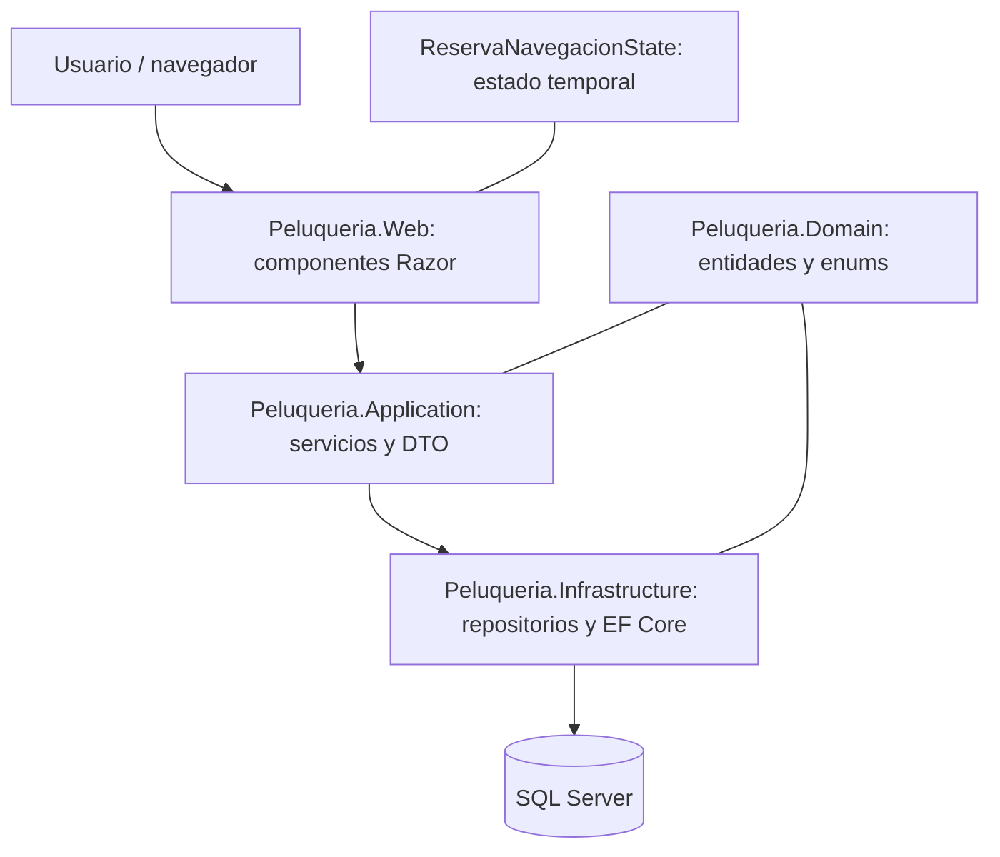
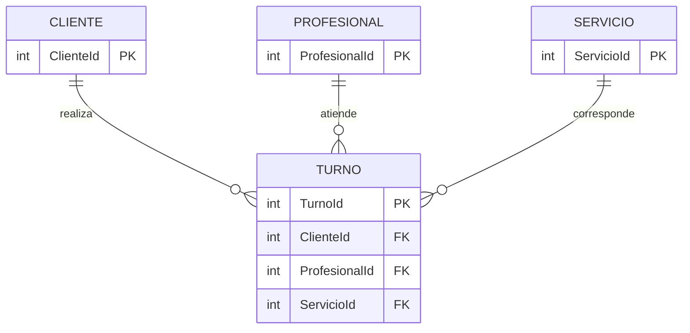

# ONDA Peluquería

**Aplicación web de gestión de peluquería y reservas de turnos, desarrollada con Blazor Server (.NET 8), C#, Entity Framework Core y SQL Server.**

Este README sirve como **documentación técnica del Proyecto Integrador de Desarrollo Web con Blazor** y como guía para localizar en el código la evidencia de cada requisito de las Unidades 1, 2 y 3, además de los pendientes de entrega de la Unidad 4.

> **Base de esta documentación:** revisión del código contenido en `Peluqueria(2).zip` (16/11/2026). Se describen implementaciones verificadas en los archivos; no implica que se haya ejecutado una compilación o prueba automática. Todas las rutas enlazadas son relativas a la carpeta raíz `Peluqueria` del repositorio.

## Índice

1. [Descripción y funciones](#1-descripción-y-funciones)
2. [Tecnologías y arquitectura](#2-tecnologías-y-arquitectura)
3. [Mapa rápido de requisitos académicos](#3-mapa-rápido-de-requisitos-académicos)
4. [Unidad 1: componentes, formularios, routing y estado](#4-unidad-1-componentes-formularios-routing-y-estado)
5. [Unidad 2: HTML semántico, CSS Isolation, Bootstrap y JS Interop](#5-unidad-2-html-semántico-css-isolation-bootstrap-y-js-interop)
6. [Unidad 3: Entity Framework Core y CRUD](#6-unidad-3-entity-framework-core-y-crud)
7. [Unidad 4: Git, CI/CD y despliegue](#7-unidad-4-git-cicd-y-despliegue)
8. [Instalación y ejecución local](#8-instalación-y-ejecución-local)
9. [Rutas y demostración para la defensa](#9-rutas-y-demostración-para-la-defensa)
10. [Observaciones y tareas pendientes](#10-observaciones-y-tareas-pendientes)

## 1. Descripción y funciones

ONDA Peluquería permite:

- Consultar servicios y profesionales activos, con una interfaz pública y responsive.
- Reservar turnos eligiendo **servicio, profesional, fecha y horario**, e ingresando nombre y teléfono.
- Elegir **«Cualquier profesional»** cuando corresponda: la selección temporal puede ser `null` y la asignación se resuelve mediante los servicios existentes.
- Generar un **código de reserva** y copiarlo al portapapeles.
- Consultar y cancelar reservas mediante su código, cuando el estado y horario lo permiten.
- Administrar **servicios, profesionales y clientes**, con inicio de sesión, búsqueda, paginación, alta, edición y desactivación lógica.

La interfaz usa la identidad visual ONDA: fondo crema, terracota, tipografía de títulos serif, tarjetas y controles redondeados.

## 2. Tecnologías y arquitectura

| Área | Tecnología |
|---|---|
| Frontend | .NET 8, componentes Razor, Blazor con `InteractiveServer` |
| Maquetación | HTML5, CSS, CSS Isolation, Bootstrap 5 |
| Interactividad | C#, `EventCallback`, State Service, JavaScript Interop |
| Backend | Servicios de aplicación y repositorios |
| Persistencia | Entity Framework Core 8, SQL Server |
| Autenticación | ASP.NET Core Identity, rol `Administrador` |
| Versionado | Git y GitHub |

### Organización por capas

| Proyecto | Responsabilidad | Ubicación |
|---|---|---|
| **Peluqueria.Domain** | Entidades y enums del negocio | [`Peluqueria.Domain/`](Peluqueria.Domain/) |
| **Peluqueria.Application** | DTO, interfaces y servicios con la lógica de negocio | [`Peluqueria.Application/`](Peluqueria.Application/) |
| **Peluqueria.Infrastructure** | EF Core, configuración, repositorios, migraciones y seed | [`Peluqueria.Infrastructure/`](Peluqueria.Infrastructure/) |
| **Peluqueria.Web** | UI Blazor, estado de navegación, autenticación web, estilos y JavaScript | [`Peluqueria.Web/`](Peluqueria.Web/) |



## 3. Mapa rápido de requisitos académicos

| Requisito | Dónde encontrar la evidencia |
|---|---|
| HTML5 semántico | [`MainLayout.razor`](Peluqueria.Web/Components/Layout/MainLayout.razor), [`NavMenu.razor`](Peluqueria.Web/Components/Layout/NavMenu.razor), páginas de [`Components/Pages/`](Peluqueria.Web/Components/Pages/) |
| Mínimo 6 componentes reutilizables | Siete componentes activos en [`Components/Shared/`](Peluqueria.Web/Components/Shared/) (detalle en §4.1) |
| State Service con notificación reactiva | [`ReservaNavegacionState.cs`](Peluqueria.Web/State/ReservaNavegacionState.cs), [`Program.cs`](Peluqueria.Web/Program.cs), [`NavMenu.razor`](Peluqueria.Web/Components/Layout/NavMenu.razor), [`Reservar.razor`](Peluqueria.Web/Components/Pages/Reservar.razor) |
| `EditForm` y validación avanzada | [`Reservar.razor`](Peluqueria.Web/Components/Pages/Reservar.razor), [`ReservaDatosFormModel.cs`](Peluqueria.Web/Models/ReservaDatosFormModel.cs) y formularios administrativos |
| Routing con parámetros y navegación programática | [`Reservar.razor`](Peluqueria.Web/Components/Pages/Reservar.razor), [`Home.razor`](Peluqueria.Web/Components/Pages/Home.razor), [`Routes.razor`](Peluqueria.Web/Components/Routes.razor) |
| CSS Isolation en 3 componentes como mínimo | 12 archivos `.razor.css`, por ejemplo [`Reservar.razor.css`](Peluqueria.Web/Components/Pages/Reservar.razor.css), [`MiReserva.razor.css`](Peluqueria.Web/Components/Pages/MiReserva.razor.css), [`ServiceCard.razor.css`](Peluqueria.Web/Components/Shared/ServiceCard.razor.css) |
| Bootstrap 5 y responsive | [`App.razor`](Peluqueria.Web/Components/App.razor), [`Reservar.razor`](Peluqueria.Web/Components/Pages/Reservar.razor), [`MiReserva.razor`](Peluqueria.Web/Components/Pages/MiReserva.razor) |
| JS Interop | [`CopiarCodigoReserva.razor`](Peluqueria.Web/Components/Shared/CopiarCodigoReserva.razor), [`reservas.js`](Peluqueria.Web/wwwroot/js/reservas.js) |
| CRUD con búsqueda y paginación | Páginas de [`Components/Pages/Admin/`](Peluqueria.Web/Components/Pages/Admin/) y repositorios de [`Persistence/Repositories/`](Peluqueria.Infrastructure/Persistence/Repositories/) |
| EF Core y SQL Server | [`Program.cs`](Peluqueria.Web/Program.cs), [`ApplicationDbContext.cs`](Peluqueria.Infrastructure/Persistence/ApplicationDbContext.cs) |
| `DbContextFactory` | [`Program.cs`](Peluqueria.Web/Program.cs) y, por ejemplo, [`ServicioRepository.cs`](Peluqueria.Infrastructure/Persistence/Repositories/ServicioRepository.cs) |
| Dos o más entidades relacionadas | [`Turno.cs`](Peluqueria.Domain/Entities/Turno.cs), [`TurnoConfiguration.cs`](Peluqueria.Infrastructure/Persistence/Configurations/TurnoConfiguration.cs) |
| Migraciones y datos iniciales | [`Migrations/`](Peluqueria.Infrastructure/Persistence/Migrations/) y [`DatabaseSeeder.cs`](Peluqueria.Infrastructure/Persistence/DatabaseSeeder.cs) |

## 4. Unidad 1: componentes, formularios, routing y estado

### 4.1. Componentes Razor reutilizables: dónde están y dónde se usan

Los componentes se encuentran en **`Peluqueria.Web/Components/Shared/`**. Cada uno encapsula una parte de la interfaz y se comunica mediante parámetros `[Parameter]` y, cuando corresponde, eventos `EventCallback`.

| Componente y archivo | Función | Se utiliza en |
|---|---|---|
| [`ServiceCard.razor`](Peluqueria.Web/Components/Shared/ServiceCard.razor) | Tarjeta con número, nombre, duración, descripción y precio del servicio | [`Home.razor`](Peluqueria.Web/Components/Pages/Home.razor), sección **Servicios** |
| [`ProfessionalCard.razor`](Peluqueria.Web/Components/Shared/ProfessionalCard.razor) | Tarjeta del profesional con nombre, especialidad, foto ilustrativa o iniciales | [`Home.razor`](Peluqueria.Web/Components/Pages/Home.razor), sección **Equipo** |
| [`StatusBadge.razor`](Peluqueria.Web/Components/Shared/StatusBadge.razor) | Etiqueta visual según `EstadoTurno` (pendiente, confirmado, cancelado, finalizado, ausente) | [`MiReserva.razor`](Peluqueria.Web/Components/Pages/MiReserva.razor) |
| [`ConfirmDialog.razor`](Peluqueria.Web/Components/Shared/ConfirmDialog.razor) | Confirma acciones con botones y callbacks | [`MiReserva.razor`](Peluqueria.Web/Components/Pages/MiReserva.razor) y [`Admin/Servicios.razor`](Peluqueria.Web/Components/Pages/Admin/Servicios.razor), [`Admin/Profesionales.razor`](Peluqueria.Web/Components/Pages/Admin/Profesionales.razor), [`Admin/Clientes.razor`](Peluqueria.Web/Components/Pages/Admin/Clientes.razor) |
| [`SearchBox.razor`](Peluqueria.Web/Components/Shared/SearchBox.razor) | Campo de búsqueda reutilizable que comunica el texto mediante `ValueChanged` | Las tres páginas administrativas de servicios, profesionales y clientes |
| [`Pagination.razor`](Peluqueria.Web/Components/Shared/Pagination.razor) | Botones anterior/siguiente y número de página; notifica con `PaginaActualChanged` | Las tres páginas administrativas de servicios, profesionales y clientes |
| [`CopiarCodigoReserva.razor`](Peluqueria.Web/Components/Shared/CopiarCodigoReserva.razor) | Copia el código al portapapeles usando JavaScript Interop | [`Reservar.razor`](Peluqueria.Web/Components/Pages/Reservar.razor) (confirmación) y [`MiReserva.razor`](Peluqueria.Web/Components/Pages/MiReserva.razor) |

**Ejemplo de composición de componentes:**

```razor
<SearchBox Value="@Busqueda" ValueChanged="BuscarAsync"
           Etiqueta="Buscar servicios" Placeholder="Nombre o descripción..." />

<Pagination PaginaActual="@Pagina"
            PaginaActualChanged="CambiarPaginaAsync"
            TotalRegistros="@Resultados.TotalRegistros"
            TamanoPagina="@TamanoPagina" />
```

Este código está en [`Admin/Servicios.razor`](Peluqueria.Web/Components/Pages/Admin/Servicios.razor); sus equivalentes aparecen en profesionales y clientes. La página **reutiliza** los controles sin duplicar su implementación.

> **Precisión importante:** [`TurnoCard.razor`](Peluqueria.Web/Components/Shared/TurnoCard.razor) también existe, pero en este ZIP es un componente de ejemplo con un encabezado y **no tiene un uso identificado en páginas**. No se cuenta entre los siete componentes funcionales anteriores.

### 4.2. State Service: estado compartido con notificación reactiva

**Dónde se define:** [`Peluqueria.Web/State/ReservaNavegacionState.cs`](Peluqueria.Web/State/ReservaNavegacionState.cs).

**Dónde se registra en inyección de dependencias:** [`Peluqueria.Web/Program.cs`](Peluqueria.Web/Program.cs).

```csharp
builder.Services.AddScoped<ReservaNavegacionState>();
```

**Dónde se usa:**

- [`Reservar.razor`](Peluqueria.Web/Components/Pages/Reservar.razor): actualiza servicio, profesional, fecha y horario; recuerda el borrador y, al confirmar, guarda temporalmente el último código.
- [`NavMenu.razor`](Peluqueria.Web/Components/Layout/NavMenu.razor): cambia el texto del botón entre **«Reservar turno»** y **«Continuar reserva»**.
- [`MiReserva.razor`](Peluqueria.Web/Components/Pages/MiReserva.razor): utiliza `UltimoCodigoConfirmado` para precargar el código del último turno confirmado.

**Cómo se notifica el cambio:** el servicio publica el evento `Cambio` cuando se actualiza el borrador; el menú se suscribe y solicita un nuevo renderizado.

```csharp
// ReservaNavegacionState.cs
public event Action? Cambio;

public void SeleccionarHora(DateTime hora)
{
    HoraSeleccionada = hora;
    Cambio?.Invoke();
}
```

```csharp
// NavMenu.razor (fragmentos)
ReservaNavegacion.Cambio += ActualizarNavegacion;
private void ActualizarNavegacion() => _ = InvokeAsync(StateHasChanged);
// Al liberar el componente:
ReservaNavegacion.Cambio -= ActualizarNavegacion;
```

El estado es **temporal, asociado al circuito interactivo**, no se guarda en SQL Server y no almacena nombre ni teléfono del cliente. La persistencia definitiva de la reserva se realiza en el backend.

### 4.3. `EditForm` y validación avanzada

**Formulario principal:** [`Peluqueria.Web/Components/Pages/Reservar.razor`](Peluqueria.Web/Components/Pages/Reservar.razor), **paso 4 (datos personales)**.

```razor
<EditForm Model="@datosCliente" OnValidSubmit="ConfirmarReservaAsync">
    <DataAnnotationsValidator />
    <ValidationSummary />
    <!-- Campos del cliente con ValidationMessage por propiedad -->
</EditForm>
```

**Modelo de validación:** [`ReservaDatosFormModel.cs`](Peluqueria.Web/Models/ReservaDatosFormModel.cs).

- `Required`: exige nombre y teléfono.
- `StringLength`: limita longitud mínima y máxima.
- `NombreClienteValidoAttribute`: usa una expresión regular con `\p{L}` para aceptar **letras Unicode**, incluidos acentos y ñ, y espacios internos; rechaza números y símbolos.
- `TelefonoContactoValidoAttribute`: exige al menos seis dígitos, aunque admite `+`, espacios, guiones y paréntesis.
- `ValidationSummary` agrupa errores y `ValidationMessage` los coloca junto a cada campo.
- `OnValidSubmit` evita ejecutar la confirmación cuando el modelo no supera las validaciones del formulario.

**Otros formularios con `EditForm`:**

| Página | Modelo | Campos y validación |
|---|---|---|
| [`Admin/Servicios.razor`](Peluqueria.Web/Components/Pages/Admin/Servicios.razor) | [`ServicioAdminFormModel.cs`](Peluqueria.Web/Models/ServicioAdminFormModel.cs) | Nombre, precio, duración, URL y descripción; `IValidatableObject` comprueba el rango de precio |
| [`Admin/Profesionales.razor`](Peluqueria.Web/Components/Pages/Admin/Profesionales.razor) | [`ProfesionalFormDto.cs`](Peluqueria.Application/DTOs/Profesionales/ProfesionalFormDto.cs) | Nombre, contacto, especialidad y demás datos del profesional |
| [`Admin/Clientes.razor`](Peluqueria.Web/Components/Pages/Admin/Clientes.razor) | [`ClienteFormDto.cs`](Peluqueria.Application/DTOs/Clientes/ClienteFormDto.cs) | Nombre, teléfono y observaciones |

El formulario público realiza además comprobaciones de servicio, fecha, horario y disponibilidad antes de solicitar la reserva. **Las validaciones visuales no reemplazan las validaciones del backend**.

### 4.4. Routing con parámetros y navegación programática

**Archivo central del router:** [`Peluqueria.Web/Components/Routes.razor`](Peluqueria.Web/Components/Routes.razor).

**Rutas parametrizadas:** en [`Reservar.razor`](Peluqueria.Web/Components/Pages/Reservar.razor):

```razor
@page "/reservar"
@page "/reservar/servicio/{ServicioId:int}"

@code {
    [Parameter] public int? ServicioId { get; set; }
}
```

Desde [`Home.razor`](Peluqueria.Web/Components/Pages/Home.razor), la sección de servicios crea enlaces como `/reservar/servicio/2`. `Reservar.razor` lee el ID y verifica que corresponda a un servicio disponible antes de precargar la selección.

**Navegación programática:** en [`Reservar.razor`](Peluqueria.Web/Components/Pages/Reservar.razor) se utiliza `NavigationManager.NavigateTo`, por ejemplo:

```csharp
private void IrAMiReserva() => Navegacion.NavigateTo("/mi-reserva");
```

El código de reserva se comparte mediante `ReservaNavegacionState` y no es necesario colocarlo en la URL.

## 5. Unidad 2: HTML semántico, CSS Isolation, Bootstrap y JS Interop

### 5.1. ¿Dónde se usa HTML5 semántico?

**Layout principal:** [`Peluqueria.Web/Components/Layout/MainLayout.razor`](Peluqueria.Web/Components/Layout/MainLayout.razor).

```razor
<header class="onda-header"><NavMenu /></header>
<main id="contenido-principal" class="onda-main">@Body</main>
<footer class="onda-footer"> ... </footer>
```

**Navegación:** [`NavMenu.razor`](Peluqueria.Web/Components/Layout/NavMenu.razor) utiliza `<nav aria-label="Navegación principal">`.

**Otras ubicaciones:**

- [`Home.razor`](Peluqueria.Web/Components/Pages/Home.razor): `<section>` para servicios, equipo, galería y contacto; encabezados `<h1>` / `<h2>`, imágenes con `alt` y `<blockquote>`.
- [`ServiceCard.razor`](Peluqueria.Web/Components/Shared/ServiceCard.razor) y [`ProfessionalCard.razor`](Peluqueria.Web/Components/Shared/ProfessionalCard.razor): `<article>` para cada tarjeta.
- [`MiReserva.razor`](Peluqueria.Web/Components/Pages/MiReserva.razor): `<header>` y `<section>` con descripción accesible del detalle de reserva.
- [`Admin/Servicios.razor`](Peluqueria.Web/Components/Pages/Admin/Servicios.razor), [`Admin/Profesionales.razor`](Peluqueria.Web/Components/Pages/Admin/Profesionales.razor) y [`Admin/Clientes.razor`](Peluqueria.Web/Components/Pages/Admin/Clientes.razor): tablas con `<table>`, `<thead>`, `<tbody>` y encabezados `<th scope="col">`.
- Formularios: etiquetas `<label>` asociadas a sus campos, más `role="status"` o `role="alert"` para mensajes.

**Qué demuestra:** la estructura identifica el propósito de cada zona para accesibilidad, mantenimiento y navegación.

### 5.2. ¿Dónde se usa CSS Isolation?

Los estilos aislados viven junto al `.razor` correspondiente, con el nombre **`Componente.razor.css`**. El build de Blazor genera la hoja consolidada `Peluqueria.Web.styles.css`, referenciada en [`App.razor`](Peluqueria.Web/Components/App.razor).

| Componente / página | CSS Isolation |
|---|---|
| Reserva pública | [`Reservar.razor.css`](Peluqueria.Web/Components/Pages/Reservar.razor.css) |
| Consulta de reservas | [`MiReserva.razor.css`](Peluqueria.Web/Components/Pages/MiReserva.razor.css) |
| Inicio | [`Home.razor.css`](Peluqueria.Web/Components/Pages/Home.razor.css) |
| Tarjetas de servicios | [`ServiceCard.razor.css`](Peluqueria.Web/Components/Shared/ServiceCard.razor.css) |
| Tarjetas de profesionales | [`ProfessionalCard.razor.css`](Peluqueria.Web/Components/Shared/ProfessionalCard.razor.css) |
| Estado de reserva | [`StatusBadge.razor.css`](Peluqueria.Web/Components/Shared/StatusBadge.razor.css) |
| Diálogo de confirmación | [`ConfirmDialog.razor.css`](Peluqueria.Web/Components/Shared/ConfirmDialog.razor.css) |
| Búsqueda | [`SearchBox.razor.css`](Peluqueria.Web/Components/Shared/SearchBox.razor.css) |
| Paginación | [`Pagination.razor.css`](Peluqueria.Web/Components/Shared/Pagination.razor.css) |
| Copiar código | [`CopiarCodigoReserva.razor.css`](Peluqueria.Web/Components/Shared/CopiarCodigoReserva.razor.css) |
| Layout general | [`MainLayout.razor.css`](Peluqueria.Web/Components/Layout/MainLayout.razor.css) |
| Menú | [`NavMenu.razor.css`](Peluqueria.Web/Components/Layout/NavMenu.razor.css) |

Se identificaron **12 archivos `.razor.css`**, por encima del mínimo académico de tres. Además existen los estilos globales [`wwwroot/app.css`](Peluqueria.Web/wwwroot/app.css) y [`wwwroot/css/onda-admin.css`](Peluqueria.Web/wwwroot/css/onda-admin.css). **Esos dos archivos son CSS global, no CSS Isolation.**

### 5.3. ¿Dónde está Bootstrap 5 y cómo se utiliza?

- Biblioteca local: [`Peluqueria.Web/wwwroot/bootstrap/bootstrap.min.css`](Peluqueria.Web/wwwroot/bootstrap/bootstrap.min.css).
- Importación: [`Peluqueria.Web/Components/App.razor`](Peluqueria.Web/Components/App.razor).

```html
<link rel="stylesheet" href="bootstrap/bootstrap.min.css" />
```

**Aplicaciones concretas:**

- [`Reservar.razor`](Peluqueria.Web/Components/Pages/Reservar.razor): `row g-4 align-items-start`, `col-12 col-xl-9` y `col-12 col-xl-3` para formulario y resumen.
- [`MiReserva.razor`](Peluqueria.Web/Components/Pages/MiReserva.razor): `row g-4` con `col-12 col-xl-8` y `col-12 col-xl-4` para consulta y panel de ayuda.
- [`CopiarCodigoReserva.razor`](Peluqueria.Web/Components/Shared/CopiarCodigoReserva.razor): `d-flex flex-column flex-sm-row align-items-start align-items-sm-center gap-2`.

**Enfoque mobile-first:** `col-12` ocupa todo el ancho en celulares; desde `xl` se divide en columnas, y `flex-sm-row` cambia la disposición al alcanzar el breakpoint `sm`. Los detalles de color, tipografía y bordes siguen siendo personalizados para ONDA.

### 5.4. ¿Dónde se usa JavaScript Interop?

**Funcionalidad concreta:** **«Copiar código»** en la confirmación de una reserva y en su consulta.

| Parte | Archivo |
|---|---|
| Componente Blazor con `IJSRuntime` | [`CopiarCodigoReserva.razor`](Peluqueria.Web/Components/Shared/CopiarCodigoReserva.razor) |
| JavaScript ES6 | [`wwwroot/js/reservas.js`](Peluqueria.Web/wwwroot/js/reservas.js) |
| Pantallas que usan el botón | [`Reservar.razor`](Peluqueria.Web/Components/Pages/Reservar.razor) y [`MiReserva.razor`](Peluqueria.Web/Components/Pages/MiReserva.razor) |

```csharp
// Fragmentos de CopiarCodigoReserva.razor
@inject IJSRuntime JS
@implements IAsyncDisposable

modulo = await JS.InvokeAsync<IJSObjectReference>("import", "./js/reservas.js");
await modulo.InvokeVoidAsync("copiarCodigo", Codigo);
```

```javascript
// wwwroot/js/reservas.js
export async function copiarCodigo(codigo) {
    if (typeof codigo !== 'string' || !codigo.trim()) {
        throw new Error('No hay un código de reserva para copiar.');
    }
    if (!window.isSecureContext || !navigator.clipboard?.writeText) {
        throw new Error('El navegador no admite el portapapeles seguro en este contexto.');
    }
    await navigator.clipboard.writeText(codigo);
}
```

**Por qué requiere JavaScript:** la API `navigator.clipboard.writeText()` pertenece al navegador. El componente la llama desde C# mediante JS Interop. También muestra mensajes de éxito/error y libera el módulo con `IAsyncDisposable` para gestionar su ciclo de vida. Se requiere **HTTPS o `localhost`** para utilizar el portapapeles seguro.

## 6. Unidad 3: Entity Framework Core y CRUD

### 6.1. EF Core con SQL Server y `DbContextFactory`

La base seleccionada es **SQL Server**, una alternativa expresamente permitida por la consigna (no se utiliza SQLite).

**Configuración de la conexión e inyección:** [`Peluqueria.Web/Program.cs`](Peluqueria.Web/Program.cs).

```csharp
var connectionString = builder.Configuration
    .GetConnectionString("DefaultConnection")
    ?? throw new InvalidOperationException(
        "No se encontró la cadena de conexión 'DefaultConnection'.");

builder.Services.AddDbContextFactory<ApplicationDbContext>(
    options => options.UseSqlServer(connectionString));
```

**Contexto de datos:** [`Peluqueria.Infrastructure/Persistence/ApplicationDbContext.cs`](Peluqueria.Infrastructure/Persistence/ApplicationDbContext.cs), que hereda de `IdentityDbContext<ApplicationUser>` y contiene:

- `DbSet<Cliente> Clientes`
- `DbSet<Profesional> Profesionales`
- `DbSet<Servicio> Servicios`
- `DbSet<Turno> Turnos`
- `DbSet<HorarioAtencion> HorariosAtencion`

**Uso de la factoría:** en los repositorios como [`ServicioRepository.cs`](Peluqueria.Infrastructure/Persistence/Repositories/ServicioRepository.cs), [`ClienteRepository.cs`](Peluqueria.Infrastructure/Persistence/Repositories/ClienteRepository.cs) y [`ProfesionalRepository.cs`](Peluqueria.Infrastructure/Persistence/Repositories/ProfesionalRepository.cs):

```csharp
private readonly IDbContextFactory<ApplicationDbContext> _factory;

// Dentro de los métodos de repositorio:
await using var db = await _factory.CreateDbContextAsync(cancellationToken);
```

Esto crea un contexto de vida corta para cada operación; los componentes Razor **no acceden directamente** a la base de datos, sino a los servicios de aplicación.

### 6.2. Entidades relacionadas

**Entidades:** [`Peluqueria.Domain/Entities/`](Peluqueria.Domain/Entities/).

- [`Cliente.cs`](Peluqueria.Domain/Entities/Cliente.cs)
- [`Profesional.cs`](Peluqueria.Domain/Entities/Profesional.cs)
- [`Servicio.cs`](Peluqueria.Domain/Entities/Servicio.cs)
- [`Turno.cs`](Peluqueria.Domain/Entities/Turno.cs)
- [`HorarioAtencion.cs`](Peluqueria.Domain/Entities/HorarioAtencion.cs)

**Ejemplo principal:** un `Turno` contiene `ClienteId`, `ProfesionalId` y `ServicioId`, además de las propiedades de navegación `Cliente`, `Profesional` y `Servicio`. Las relaciones se configuran con Fluent API en [`TurnoConfiguration.cs`](Peluqueria.Infrastructure/Persistence/Configurations/TurnoConfiguration.cs).

```csharp
builder.HasOne(t => t.Cliente)
    .WithMany(c => c.Turnos)
    .HasForeignKey(t => t.ClienteId)
    .OnDelete(DeleteBehavior.Restrict);

builder.HasOne(t => t.Profesional)
    .WithMany(p => p.Turnos)
    .HasForeignKey(t => t.ProfesionalId)
    .OnDelete(DeleteBehavior.Restrict);
```



Con tres relaciones uno-a-muchos se supera el mínimo de **dos entidades relacionadas**.

### 6.3. Migraciones versionadas y seed

**Migraciones existentes:** [`Peluqueria.Infrastructure/Persistence/Migrations/`](Peluqueria.Infrastructure/Persistence/Migrations/).

| Archivo | Propósito |
|---|---|
| [`20260917204454_InitialCreate.cs`](Peluqueria.Infrastructure/Persistence/Migrations/20260917204454_InitialCreate.cs) | Migración inicial de esquema |
| [`20260928221044_FixEstadoTurnoDefault.cs`](Peluqueria.Infrastructure/Persistence/Migrations/20260928221044_FixEstadoTurnoDefault.cs) | Ajuste del valor predeterminado del estado del turno |
| [`ApplicationDbContextModelSnapshot.cs`](Peluqueria.Infrastructure/Persistence/Migrations/ApplicationDbContextModelSnapshot.cs) | Instantánea del modelo usada por EF Core para comparar cambios |

**Datos iniciales (seed):** [`DatabaseSeeder.cs`](Peluqueria.Infrastructure/Persistence/DatabaseSeeder.cs).

El método `SeedAsync()` llama a `context.Database.MigrateAsync()` y después crea, **si no existen**, el rol `Administrador`, el usuario administrador, profesionales de ejemplo, servicios de ejemplo y horarios de atención.

**Dónde se invoca:** [`Program.cs`](Peluqueria.Web/Program.cs), en un bloque que se ejecuta **solo si `app.Environment.IsDevelopment()`**. En un despliegue productivo es necesario establecer una estrategia explícita de migración/inicialización; no se debe asumir que el seed se ejecutará automáticamente.

### 6.4. CRUD completo con búsqueda y paginación

**Pantallas administrativas:**

| Recurso | Interfaz | Servicio de aplicación | Repositorio EF Core |
|---|---|---|---|
| Servicios | [`Admin/Servicios.razor`](Peluqueria.Web/Components/Pages/Admin/Servicios.razor) | [`ServicioService.cs`](Peluqueria.Application/Services/ServicioService.cs) | [`ServicioRepository.cs`](Peluqueria.Infrastructure/Persistence/Repositories/ServicioRepository.cs) |
| Profesionales | [`Admin/Profesionales.razor`](Peluqueria.Web/Components/Pages/Admin/Profesionales.razor) | [`ProfesionalService.cs`](Peluqueria.Application/Services/ProfesionalService.cs) | [`ProfesionalRepository.cs`](Peluqueria.Infrastructure/Persistence/Repositories/ProfesionalRepository.cs) |
| Clientes | [`Admin/Clientes.razor`](Peluqueria.Web/Components/Pages/Admin/Clientes.razor) | [`ClienteService.cs`](Peluqueria.Application/Services/ClienteService.cs) | [`ClienteRepository.cs`](Peluqueria.Infrastructure/Persistence/Repositories/ClienteRepository.cs) |

| Operación | Cómo se realiza |
|---|---|
| **Create / Crear** | Botón «Nuevo», `EditForm` y llamada a `CrearAsync()` |
| **Read / Leer** | `ListarAsync()` consulta los registros y los muestra en una tabla |
| **Update / Actualizar** | Botón «Editar», carga los datos y llama a `ActualizarAsync()` |
| **Delete / Borrar lógicamente** | Botón «Desactivar» con `ConfirmDialog`, seguido de `DesactivarAsync()`; establece el registro como inactivo **sin borrarlo físicamente** |
| **Buscar** | `SearchBox` notifica a `BuscarAsync`, que reinicia la página y consulta de nuevo |
| **Paginar** | `Pagination` notifica a `CambiarPaginaAsync`; el repositorio aplica `Skip()` y `Take()` en SQL Server |

**Ejemplo en [`ServicioRepository.cs`](Peluqueria.Infrastructure/Persistence/Repositories/ServicioRepository.cs):**

```csharp
if (!string.IsNullOrWhiteSpace(busqueda))
    query = query.Where(s => s.Nombre.Contains(busqueda) ||
        (s.Descripcion != null && s.Descripcion.Contains(busqueda)));

var total = await query.CountAsync(cancellationToken);
var items = await query.OrderBy(s => s.Nombre)
    .ThenBy(s => s.ServicioId)
    .Skip((pagina - 1) * tamanoPagina)
    .Take(tamanoPagina)
    // Continúa con Select(...) y ToListAsync(...).
```

La paginación ocurre **en la consulta a SQL Server**, no como un simple recorte visual de todos los resultados. El tamaño de página de las tres pantallas administrativas está configurado en **10 registros**.

**Nota sobre «CRUD completo»:** la operación de eliminación de ONDA es **baja lógica** (`Activo = false`), por decisión de integridad y conservación del historial de reservas. Debe explicarse al docente si interpreta *Delete* exclusivamente como eliminación física.

## 7. Unidad 4: Git, CI/CD y despliegue

**Repositorio:** el ZIP contiene información de Git y la rama de trabajo `feature/frontend`. En los últimos cambios se utilizan mensajes con el formato **Conventional Commits**, por ejemplo `feat(admin): implementar panel administrativo y CRUD`.

**Estado de la consigna de entrega en el ZIP analizado:**

| Requisito de entrega | Estado documentado |
|---|---|
| Git y trabajo por ramas | Historial presente en el ZIP |
| Mensajes Conventional Commits | Presentes en commits recientes; el historial completo requiere revisión antes de afirmar uniformidad |
| README profesional | **Este archivo**, preparado para incorporarse a la raíz del repositorio |
| GitHub Actions con build automático | **Pendiente**: no se encontró workflow en `.github/workflows/` |
| Deploy automático | **Pendiente** de configurar y verificar |
| URL pública accesible | **No verificada** con los materiales disponibles |
| CHANGELOG | **Pendiente**: no se encontró `CHANGELOG.md` |

No se incluye una URL inventada ni se presenta como realizado un despliegue que todavía no se verificó.

## 8. Instalación y ejecución local

### Requisitos previos

- **SDK .NET 8** y Visual Studio o Visual Studio Code con soporte C#.
- **SQL Server** disponible (por ejemplo, una instancia local de desarrollo).
- Conexión configurada a una base que permita aplicar las migraciones de EF Core.
- Acceso a la raíz del repositorio, donde se encuentra `Peluqueria.slnx` y los cuatro proyectos. Los comandos de ejemplo apuntan al proyecto web para que funcionen con el SDK .NET 8.

### Pasos

**1. Abrir la solución.** Desde la carpeta raíz `Peluqueria`, comprobar el SDK y restaurar paquetes:

```powershell
dotnet --version
dotnet restore Peluqueria.Web/Peluqueria.Web.csproj
```

**2. Configurar secretos de desarrollo.** El proyecto web dispone de `UserSecretsId`, por lo que se pueden usar **User Secrets** para no guardar credenciales en Git. Sustituir todos los valores de ejemplo:

```powershell
dotnet user-secrets set "ConnectionStrings:DefaultConnection" "Server=SERVIDOR_SQL;Database=NOMBRE_BASE;Trusted_Connection=True;TrustServerCertificate=True" --project Peluqueria.Web

dotnet user-secrets set "Seed:AdminPassword" "CONTRASEÑA_SEGURA_Y_UNICA" --project Peluqueria.Web
```

La cadena de conexión exacta depende de la instancia SQL Server y de su modalidad de autenticación. **No publicar contraseñas, credenciales de base de datos ni `secrets.json`.**

**3. Compilar y ejecutar:**

```powershell
dotnet build Peluqueria.Web/Peluqueria.Web.csproj
dotnet run --project Peluqueria.Web
```

En el entorno `Development`, el inicio de la aplicación ejecuta [`DatabaseSeeder.SeedAsync()`](Peluqueria.Infrastructure/Persistence/DatabaseSeeder.cs), que aplica migraciones y carga datos iniciales cuando corresponda. **No crea una nueva base distinta de la configurada**: trabaja contra la conexión `DefaultConnection`.

**4. Abrir en el navegador** la URL `https://localhost:PUERTO` indicada por Visual Studio o por la terminal. El puerto puede variar según la configuración local.

**5. Acceso administrativo:** navegar a `/admin/acceso`. El seed define el correo de desarrollo `admin@peluqueria.local`; la contraseña debe configurarse en secretos y **no se imprime aquí**. Cuando el usuario ya existe, el seed **no reemplaza automáticamente su contraseña**.

## 9. Rutas y demostración para la defensa

### Rutas principales

| Ruta | Función |
|---|---|
| `/` | Página de inicio: servicios, equipo, galería y contacto |
| `/reservar` | Flujo público de reserva |
| `/reservar/servicio/{ServicioId:int}` | Reserva con servicio precargado mediante parámetro de ruta |
| `/mi-reserva` | Consulta y posible cancelación mediante código |
| `/admin/acceso` | Inicio de sesión administrativo |
| `/admin` | Portada de administración |
| `/admin/servicios` | Gestión de servicios |
| `/admin/profesionales` | Gestión de profesionales |
| `/admin/clientes` | Gestión de clientes |

### Guion sugerido de demostración

1. **Inicio:** mostrar el uso de HTML semántico y los componentes `ServiceCard` / `ProfessionalCard`.
2. **Reserva:** elegir servicio desde Inicio para demostrar `/reservar/servicio/{id}`; pasar por los cinco pasos.
3. **Validación:** escribir números en el nombre o un teléfono inválido para mostrar `EditForm` y los atributos personalizados.
4. **Estado reactivo:** dejar una reserva en curso, navegar al Inicio y mostrar «Continuar reserva»; explicar el evento `Cambio`.
5. **Confirmación:** completar una reserva de prueba; usar **Copiar código** para demostrar JS Interop.
6. **Consulta:** visitar «Mi reserva», recuperar el código confirmado y mostrar `StatusBadge` / `ConfirmDialog`.
7. **Administración:** entrar como administrador y demostrar crear, editar, buscar, paginar y desactivar un registro de prueba.
8. **Persistencia:** abrir `ApplicationDbContext`, `TurnoConfiguration`, los repositorios, las migraciones y el seed para explicar el modelo SQL Server.

## 10. Observaciones y tareas pendientes

Estas observaciones evitan presentar como terminadas características que el ZIP no acredita completamente:

- **Autorización de rutas:** [`Routes.razor`](Peluqueria.Web/Components/Routes.razor) utiliza `RouteView`, aunque las páginas administrativas declaran `[Authorize(Roles = "Administrador")]`. Antes del despliegue hay que revisar la integración con `AuthorizeRouteView` y **probar que un visitante anónimo no pueda acceder al panel**.
- **Componente administrativo faltante en el ZIP:** las páginas de administración invocan `<AdminNavegacion />`, pero no se encontró el archivo de componente correspondiente en esta copia. Debe revisarse si existe en tu proyecto local y no se incluyó en el ZIP.
- **TurnoCard:** es un placeholder sin implementación funcional ni referencias de uso verificadas; no se cuenta en el requisito de seis componentes.
- **GitHub Actions, despliegue público y CHANGELOG:** faltan o no pudieron verificarse; deben completarse para cerrar la Unidad 4.
- **Migraciones en producción:** la ejecución automática del seed/migración está limitada al entorno `Development`; planificar su aplicación en el servidor.
- **Pruebas:** validar con compilación, navegación, reserva real, autorización, CRUD y dispositivos móviles. La presencia del código no sustituye estas pruebas.

---

**ONDA Peluquería — Proyecto Integrador académico.** Esta documentación identifica el código fuente real que demuestra los requisitos evaluados y deja explícitos los puntos pendientes de verificación y entrega.
